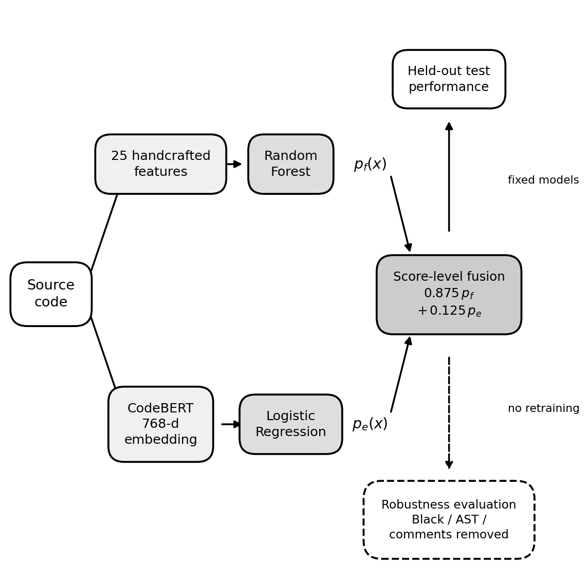
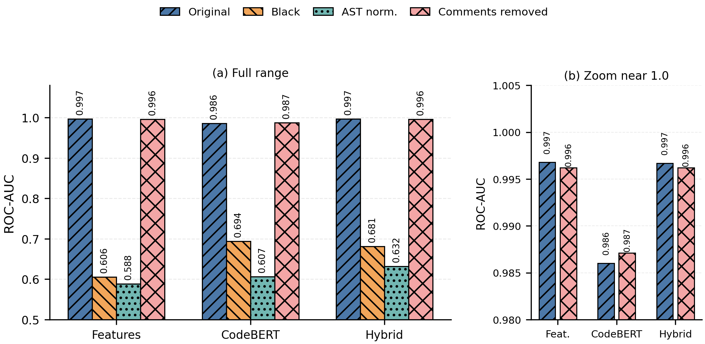

# Beyond Whitespace
## Evaluating Machine-Generated Code Detectors Under Formatting Shifts

This repository studies how to distinguish AI-generated source code from human-written code—and what code-origin detectors actually learn. Such detection can inform authorship attribution and academic integrity research, but high benchmark accuracy alone does not establish reliable detection in practice. Models may learn formatting conventions or dataset artifacts that change when the same program is reformatted.

The revised study compares **25 handcrafted features + Random Forest**, **frozen CodeBERT embeddings + Logistic Regression**, and **score-level hybrid fusion**. Formatting and normalization experiments test whether predictions remain stable when code presentation changes.

[Results and interpretation](docs/results.md) · [Reproduction guide](docs/reproducibility.md) · [Canonical experiment](experiments/canonical70k/README.md) · [Repository audit](docs/repository-audit.md)

### Research papers

| Version | Title | Status |
| --- | --- | --- |
| 1 | [Whitespaces Don't Lie: Feature-Driven and Embedding-Based Approaches for Detecting Machine-Generated Code](https://arxiv.org/abs/2601.19264) | Public arXiv preprint, submitted January 27, 2026 |
| 2 | Beyond Whitespace: Evaluating Machine-Generated Code Detectors Under Formatting Shifts | Revised manuscript submitted for review in 2026; under review, not accepted or published |

Version 2 extends Version 1 within the same research project. It adds a frozen 70,000-sample protocol, fusion, artifact controls, ablations, and paired robustness analysis. The preprint used an earlier protocol; its results should not be substituted for the canonical results below. The revised manuscript is not distributed here; any future upload requires checking the applicable submission policies.

### Research questions

1. **RQ1:** How well do handcrafted features and frozen CodeBERT embeddings detect machine-generated code under a fixed held-out protocol?
2. **RQ2:** Do the detectors contain complementary information that can improve results through score-level fusion?
3. **RQ3:** How much performance depends on dataset artifacts or presentation-level cues, and how stable are predictions after formatting changes?

### Key contributions

- Comparison of feature-based and frozen embedding-based classifiers under one train/validation/test protocol.
- Validation-selected score-level fusion and paired bootstrap comparisons with the feature baseline.
- Dataset audits, feature ablations, and parseability controls to investigate possible shortcuts.
- Paired evaluation of original and transformed code on a fixed common cohort, with trained models and decision thresholds held constant.
- Evidence about the limits of in-distribution benchmark accuracy as a guide to robustness.

### Key results

**Reported in the revised manuscript: held-out test set, N = 10,000.** Existing local canonical tables were inspected for this update; the [results summary](docs/results.md#provenance-and-scope) records a small RF F1 rounding discrepancy. The experiments were **not independently reproduced** during this update. PR-AUC is computed as average precision in the implementation.

| Model | ROC-AUC | PR-AUC | F1 |
| --- | ---: | ---: | ---: |
| Random Forest (25 handcrafted features) | 0.9945 | 0.9946 | 0.9695 |
| CodeBERT (frozen encoder + Logistic Regression) | 0.9716 | 0.9737 | 0.9301 |
| Hybrid (score-level fusion) | 0.9948 | 0.9953 | 0.9706 |

Fusion gives small improvements; the saved paired 95% confidence interval for its ROC-AUC gain over RF includes zero. See the [results summary](docs/results.md) for intervals and controls.

**Reported in the revised manuscript: hybrid robustness on the same fixed parseable-Python cohort, N = 6,473** (4,362 human / 2,111 AI). This is a subset of the held-out test set. All three transformations succeeded on this cohort in the saved artifacts.

| Condition | Hybrid ROC-AUC |
| --- | ---: |
| Original | 0.9967 |
| Black formatting | 0.6807 |
| AST normalization | 0.6320 |
| Comment removal | 0.9962 |

Hybrid predictions change for approximately 61% of paired samples under Black formatting or AST normalization (60.71% and 61.89%, respectively, in the saved tables). These are separate comparisons against the original predictions. The drops show sensitivity to presentation changes despite strong original-test performance.

### Experiment figures

The existing canonical figures illustrate the pipeline and reported robustness results; they are not evidence of a new reproduction run.





### Methodology

The canonical experiment samples from the SemEval-2026 Task 13 Task A training data. It reports and excludes normalized-code groups with conflicting labels, removes exact and normalized duplicates, then samples and splits by **label + language** with **seed 42**: **50,000 train / 10,000 validation / 10,000 test**. Generator is not a splitting stratum. Code hashes are disjoint across splits; this does not ensure that related programming tasks are disjoint.

The feature branch extracts 25 text, identifier, and Python-AST features directly from code. The embedding branch uses `microsoft/codebert-base`, truncates at 512 tokens, applies attention-mask mean pooling, and L2-normalizes the resulting 768-dimensional vectors. The encoder is frozen. RF uses 300 trees; LR is trained on the embeddings.

Decision thresholds maximize validation F1. Hybrid fusion uses `p = α × p_RF + (1 − α) × p_CodeBERT`; validation PR-AUC selects α, with validation F1 as the tie-break. The saved selection is α = 0.875 and hybrid threshold = 0.570. Test labels do not select thresholds or fusion weights.

Final analyses include Python-only feature ablations, a separately trained parseable-Python RF control, and fixed-model robustness tests. Robustness uses the intersection of successful Black, AST-unparse, and comment-only transformations on originally parseable Python test snippets. Original and transformed predictions use identical IDs, models, weights, and thresholds. Paired bootstrap resampling uses the same sampled indices for both sides of each comparison.

### Repository structure

```text
experiments/canonical70k/
  config.yaml       Frozen scientific configuration
  manifests/        Tracked metadata/ID index; full code manifests are local
  figures/          Canonical figures and plotting scripts
  features/         Generated local arrays (ignored)
  embeddings/       Generated local CodeBERT arrays (ignored)
  models/           Generated local classifiers (ignored)
  results/          Generated local metrics/probabilities (ignored)
scripts/canonical70k/
  01–04             Split, audit, feature extraction, embedding extraction
  05_stage4_*       Canonical baseline training and hybrid selection
  06_stage5_*       Canonical final controls and robustness analysis
feature/            Shared extractor, embedding and transformation utilities
docs/               Reproduction, public results, audit and validation notes
tests/              Synthetic, dataset-free unit tests
train-model/        Earlier/exploratory training scripts and artifacts
robustness/         Earlier robustness workflow using legacy CSVs/splits
process-data/       Exploratory data conversion and embedding tools
```

Use the [six canonical entry points](docs/reproducibility.md#commands-and-frozen-artifacts). Other numbered scripts in `scripts/canonical70k/` belong to an earlier artifact interface and are **not interchangeable** with the Stage-4/5 scripts. Earlier root-level extractors, `test-model/`, and `plot/` are also exploratory; see the [audit](docs/repository-audit.md).

### Reproducibility

Start with the [reproduction guide](docs/reproducibility.md) for setup, upstream dataset references, CSV conversion, fresh-clone preparation, exact commands, expected artifacts, and unresolved requirements. The [canonical README](experiments/canonical70k/README.md) gives a short stage map. Large data, embeddings, and canonical models/results remain ignored; a compact public [results snapshot](docs/results/canonical70k-summary.json) records inspected artifact provenance.

### Limitations

- The sampled data are Python-heavy and drawn from an algorithmic-code benchmark.
- Parseability differs markedly by label; surface cues and dataset artifacts can provide shortcuts.
- Code-hash disjointness does not exclude related-task leakage across splits.
- CodeBERT is frozen and inputs are truncated; this does not evaluate a fine-tuned encoder or every part of long programs.
- The transformation set is limited. Parseable output is checked, but program-level semantic equivalence is not exhaustively tested.
- Results do not establish universal generalization to all generators, languages, domains, or mixed human–AI code. Detector scores alone should not be treated as proof of authorship.

### Citation

For the public preprint:

```bibtex
@misc{nirob2026whitespaces,
  title = {Whitespaces Don't Lie: Feature-Driven and Embedding-Based Approaches for Detecting Machine-Generated Code},
  author = {Syed Mehedi Hasan Nirob and Shamim Ehsan and Moqsadur Rahman and Summit Haque},
  year = {2026},
  eprint = {2601.19264},
  archivePrefix = {arXiv},
  primaryClass = {cs.SE},
  url = {https://arxiv.org/abs/2601.19264}
}
```

The revised manuscript, *Beyond Whitespace: Evaluating Machine-Generated Code Detectors Under Formatting Shifts*, is under review. No accepted-paper citation is available here.

### Authors and contact

Public-preprint authors: Syed Mehedi Hasan Nirob, Shamim Ehsan, Moqsadur Rahman, and Summit Haque, as listed on [arXiv](https://arxiv.org/abs/2601.19264).

Repository maintainer: [Syed Mehedi Hasan Nirob](https://github.com/nirobsmh). For code and reproduction questions, use [GitHub Issues](https://github.com/nirobsmh/AI-vs-Human-Code/issues).
